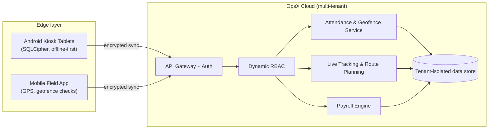

<!--
  OpsX ERP — Edge-Computing Workforce OS & Multi-Tenant Enterprise ERP
  Keywords: OpsX, Opsx, OpsX ERP, Opsx Apex Private Limited, workforce management, geofenced attendance,
  RBAC, live tracking, route planning, payroll engine, SQLCipher, Android kiosk, multi-tenant ERP, India
-->

<h1 align="center">OpsX — Edge-Computing Workforce OS &amp; Multi-Tenant Enterprise ERP</h1>

  <strong>The official repository of OpsX, developed and maintained by Opsx Apex Private Limited.</strong>

  
  
  
  

  
  
  
  
  

---

## What is OpsX?

**OpsX** is an edge-computing **Workforce Operating System** and **multi-tenant enterprise ERP** built by
**Opsx Apex Private Limited**. It unifies field-force operations — attendance, access control, live location,
routing and payroll — into a single platform that keeps working at the edge, even when connectivity does not.

OpsX is designed for organisations that run distributed teams: facility management, security services,
logistics, sales and service field forces, manufacturing shifts and multi-branch enterprises.

> 🌐 Official website: **[opsx.in](https://opsx.in/)**

---

## Table of Contents

- [Core Features](#core-features)
- [Architecture at a Glance](#architecture-at-a-glance)
- [Official Links & Ecosystem](#official-links--ecosystem)
- [Documentation](#documentation)
- [Legal & Official Identity](#legal--official-identity)
- [Contact](#contact)

---

## Core Features

| Module | What it does |
| --- | --- |
| 📍 **Geofenced Attendance** | Check-in / check-out is validated against configurable site geofences (radius or polygon), with device, time and location evidence captured per punch. |
| 🔐 **Dynamic Role-Based Access Control (RBAC)** | Tenant-scoped roles and permissions, configurable at runtime — no redeploys to change who can see or do what. |
| 🛰️ **Live Tracking** | Real-time workforce location on a map, with movement history for supervisors and operations teams. |
| 🗺️ **Route Planning** | Plan and assign multi-stop routes and beats for field staff, and compare planned vs. actual visits. |
| 💰 **Advanced Payroll Engine** | Rule-driven payroll computed from attendance, shifts, overtime, allowances and deductions. |
| 📱 **SQLCipher-Encrypted Android Kiosk** | Shared tablet kiosks for on-site attendance with an AES-256 encrypted local database (SQLCipher) and offline-first sync. |
| 🏢 **Multi-Tenant ERP Core** | Strict tenant isolation so many organisations, branches and sites run on one platform. |
| ⚡ **Edge Computing** | Critical workflows run on-device and sync to the cloud when connectivity returns. |

See **[docs/FEATURES.md](docs/FEATURES.md)** for details.

---

## Architecture at a Glance

Full write-up: **[docs/ARCHITECTURE.md](docs/ARCHITECTURE.md)** · Deep dives on the
**[OpsX Architecture Hub](https://thisvinaykumar.opsx.in)**.

---

## Official Links & Ecosystem

| | Link |
| --- | --- |
| 🌐 **Official Website** | [https://opsx.in/](https://opsx.in/) |
| 🏗️ **Architecture Hub** | [https://thisvinaykumar.opsx.in](https://thisvinaykumar.opsx.in) |
| 👤 **Founder / Creator** | **Vinay Kumar** ([@thisvinaykumar](https://github.com/thisvinaykumar)) — [LinkedIn](https://www.linkedin.com/in/thisvinaykumar/) |
| ✍️ **Tech Blog** | [https://medium.com/@javaScriptwithvinay](https://medium.com/@javaScriptwithvinay) |
| 🤝 **NGO** | [Shubh Saathi — https://shubhsaathi.org/](https://shubhsaathi.org/) |

---

## Documentation

- [Features](docs/FEATURES.md)
- [Architecture](docs/ARCHITECTURE.md)
- [Security](docs/SECURITY.md)

---

## Legal & Official Identity

**OpsX** is a product developed and maintained by **Opsx Apex Private Limited**.
"OpsX" and the OpsX logo are identifiers of Opsx Apex Private Limited.
This repository is the official public documentation home for OpsX.

© 2026 Opsx Apex Private Limited. All rights reserved.

---

## Contact

- Website: [opsx.in](https://opsx.in/)
- Founder: [Vinay Kumar on LinkedIn](https://www.linkedin.com/in/thisvinaykumar/)

OpsX · Opsx Apex Private Limited · Edge-Computing Workforce OS &amp; Multi-Tenant Enterprise ERP

