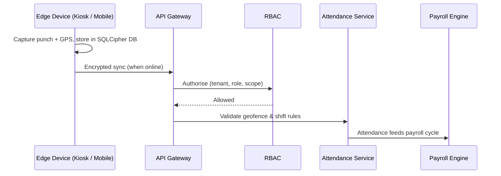

# OpsX Architecture

High-level architecture of **OpsX** by **Opsx Apex Private Limited**.
For in-depth articles, visit the **[OpsX Architecture Hub](https://thisvinaykumar.opsx.in)** and the
[tech blog](https://medium.com/@javaScriptwithvinay).

## Layers

### Edge layer
- **Android kiosk tablets** — SQLCipher-encrypted local store, offline-first attendance capture.
- **Mobile field app** — GPS, on-device geofence evaluation, live tracking, route execution.
- Edge devices queue events locally and sync over encrypted channels when connectivity returns.

### Cloud layer (multi-tenant)
- **API gateway & authentication** — every request carries a tenant context.
- **Dynamic RBAC service** — evaluates role/permission policies at runtime.
- **Attendance & geofence service** — validates punches and applies shift rules.
- **Tracking & route planning service** — ingests location streams, manages routes and beats.
- **Payroll engine** — rule-based computation driven by attendance and shift data.
- **Tenant-isolated data store** — data partitioned by tenant.

## Data flow

## Design principles
1. **Offline-first** — field operations never stop because of the network.
2. **Isolation by default** — tenant boundaries enforced at every layer.
3. **Configuration over code** — roles, geofences, shifts and pay rules are data, not deployments.
4. **Security at rest and in transit** — encrypted device storage and encrypted sync.
